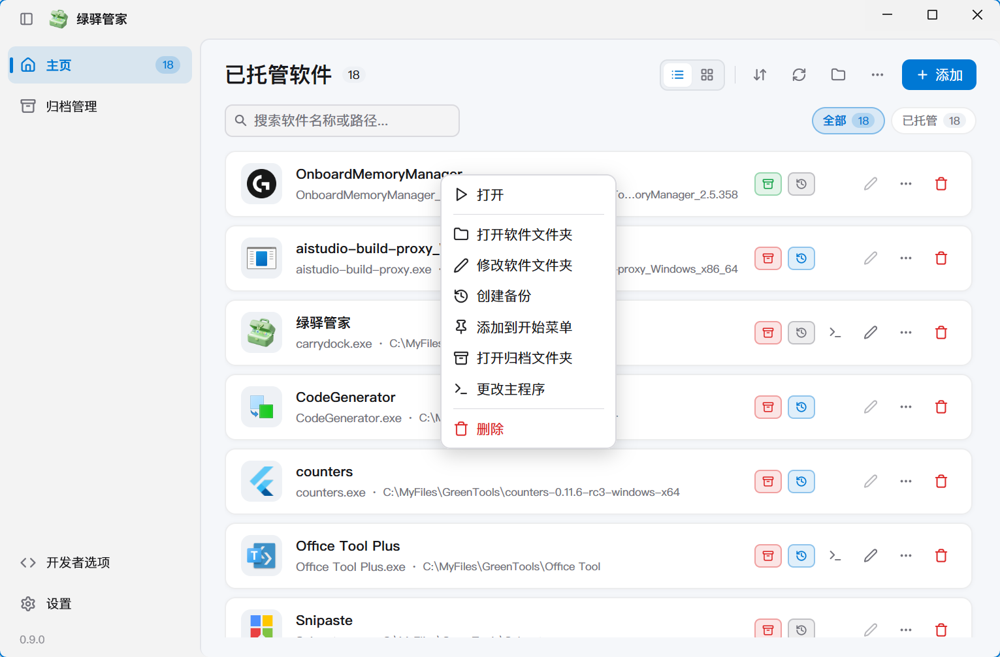
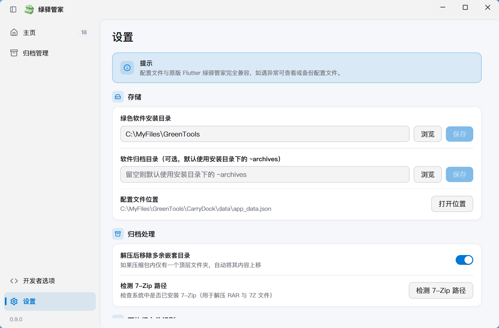

<div>

[**简体中文**](README_zh_CN.md)

</div>

# CarryDock

[](https://github.com/youzhiran/CarryDock/releases)
[](LICENSE)
[](go.mod)
[](https://github.com/youzhiran/CarryDock/releases)

CarryDock is a portable software manager built for Windows. Rewritten in pure Go with **[MyGo](https://mygo.run/docs/ui) Native UI** — rendered directly on the GPU (Direct3D 11 on Windows) with zero CGO, zero WebView2 dependency, instant startup, tiny memory footprint, and full backward compatibility with existing configuration and software list files.

[Homepage](https://carrydock.devyi.com) · [GitHub Releases](https://github.com/youzhiran/CarryDock/releases) · [Changelog](CHANGELOG.md)

<div style="text-align: center;">
  
</div>

<div style="text-align: center;">
  
</div>

## Key Features

- **Centralized Portable App Management**: Manage portable apps with instant search, list & grid views, drag-and-drop & arrow reordering, native executable version badges, compact archive/backup status indicators, unknown folder detection, and in-place version replacement/update.
- **Drag & Drop Import & Safe Extraction**: Drop archives (`ZIP`, `TAR`, `TAR.GZ`, `TAR.BZ2`, `TAR.XZ`, `GZ`, `BZ2`, `XZ`, `RAR`, `7Z`) or executables directly into the window; streaming extraction with Zip-Slip path traversal protection, GB18030/UTF-8 filename compatibility, and multi-level redundant folder flattening.
- **Smart Executable Detection & Alternative Launch**: Auto-selects single executables or prompts with extracted icons & `FileDescription`; quick-launch menu for secondary executables.
- **Developer Launch Settings & User `Path` Management**: Configure per-app custom CLI launch arguments (also applied to Start Menu `.lnk` shortcuts), temporary per-process environment variable injection (`KEY=VALUE` multiline config with `#` comments and `%INSTALL_DIR%`, `%EXE_DIR%`, `%PATH%` expansion), and one-click Windows user `Path` register/remove (auto-detecting root and common dev subdirs like `bin`, `cmd`, `Scripts`, `usr\bin`, `tools` plus custom subdirs, with automatic cleanup/migration on removal, folder rename, or version replacement).
- **Portable Relative Path Mode (USB-Ready)**: One-click atomic migration between relative and absolute paths for configuration and software list files.
- **Archive & Backup Manager**: Centralized management of archives and timestamped ZIP backups, manual link & unlink, backup/restore, re-hosting missing directories, batch scan & unified association, and automatic stale-link cleanup.
- **Native Windows Integration & Personalization**: High-DPI icon, `FileDescription` & version extraction, `ShellExecuteW` launch (UAC & special-character safe), Start Menu `.lnk` shortcuts, Windows 11 Mica vibrancy, light/dark/system mode sync, custom theme accent presets & color picker, custom fonts, and Chinese/English bilingual UI.
- **Logging, Auto-Updates & Developer Options**: Level-filtered file logging (`DEBUG` / `INFO` / `WARN` / `ERROR`), optional silent update check on startup with proxy-aware GitHub Releases self-updater, and hidden Developer Options (click Version 5 times in Settings to test icon & metadata extraction).

## Development & Build

Requires Go 1.27+.

```powershell
# Run tests and static checks
go test ./...
go vet ./...
go tool mygo vet

# Run locally
go run -tags mygo_nowebview .
# Or with MyGo live reload:
go tool mygo dev

# Build standalone Windows GUI binary (without WebView2, with embedded PE icon & version info)
$now = Get-Date -Format "yyyy-MM-dd HH:mm:ss"
$env:CGO_ENABLED="0"
$env:GOFLAGS="-tags=mygo_nowebview"
$env:MYGO_LDFLAGS="-X 'carrydock/internal/version.BuildTime=$now'"
go tool mygo build -platform windows/amd64 -skip-installer
# Output: build/windows-amd64/CarryDock.exe
```

## Data & Compatibility

- **App Config**: `<exe_dir>/data/app_data.json` (protected by `app_data.lock` and atomic writes)
- **Managed List**: `<archive_dir>/software_list.json` (protected by `software_list.lock`)
- Supports portable relative paths and remains 100% backward compatible with the legacy Flutter version.

## Changelog

See [CHANGELOG.md](CHANGELOG.md) for release history and detailed changes.

## License

This project is licensed under the [MIT License](LICENSE).
