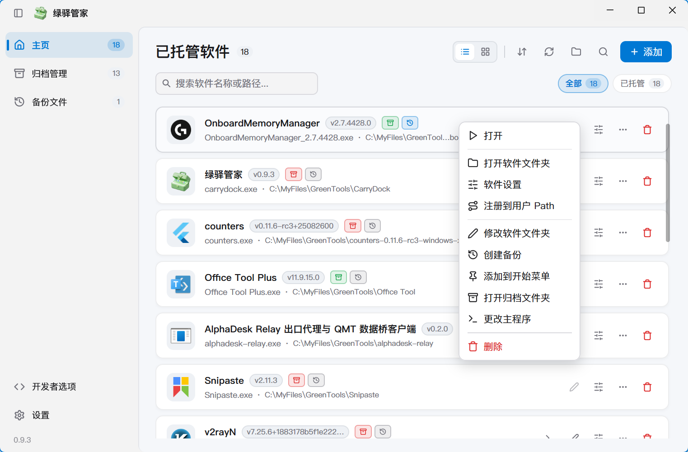
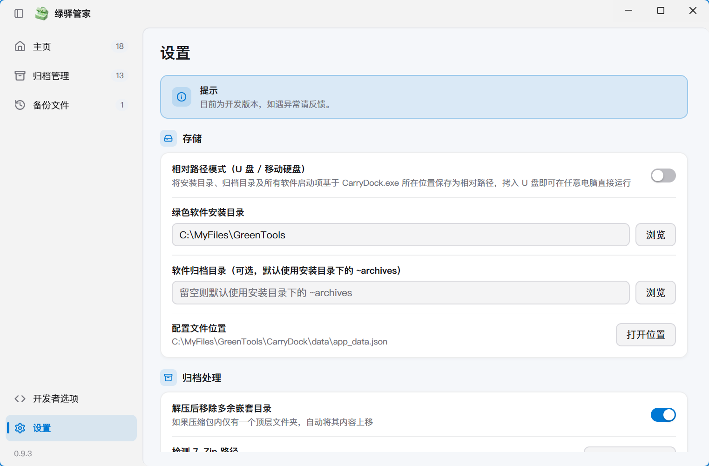

<div>

[**English**](README.md)

</div>

# CarryDock (绿驿管家)

[](https://github.com/youzhiran/CarryDock/releases)
[](LICENSE)
[](go.mod)
[](https://github.com/youzhiran/CarryDock/releases)

CarryDock（绿驿管家）是一款专为 Windows 平台设计的绿色软件（便携软件）管理器。现已使用 **Go + [MyGo](https://mygo.run/zh/docs/ui) 原生 UI** 全面重写：单文件纯 Go（无需 CGO、无需 WebView2），Direct3D 11 GPU 直接绘制界面，秒开低占用，并与原版配置文件和数据格式完全兼容。

[官方网站](https://carrydock.devyi.com) · [GitHub Releases](https://github.com/youzhiran/CarryDock/releases) · [更新日志](CHANGELOG.md)

<div style="text-align: center;">
  
</div>

<div style="text-align: center;">
  
</div>

## 核心功能

- **软件集中管理**：自动扫描安装目录，支持实时搜索、列表/网格视图一键切换、拖拽与上下微调排序、原生版本号与归档/备份状态徽章展示，以及新版覆盖替换。
- **拖拽添加与安全解压**：拖入压缩包（`ZIP` / `TAR` / `TAR.GZ` / `TAR.BZ2` / `TAR.XZ` / `GZ` / `BZ2` / `XZ` / `RAR` / `7Z`）或可执行文件即可导入；流式解压并保留原始归档，支持 GBK/GB18030 中文文件名、Zip-Slip 路径穿越防护与多层冗余目录自动展开。
- **主程序智能识别与备选启动**：单一可执行文件自动设为主程序，多个文件时弹窗展示图标与文件说明供选择；支持一键启动目录内其他备选可执行程序。
- **面向开发者的软件设置与用户 `Path` 集成**：支持在「软件设置」中配置自定义命令行启动参数（同步应用到开始菜单 `.lnk` 快捷方式）、临时注入进程级环境变量（`KEY=VALUE` 多行配置，支持 `#` 注释及 `%INSTALL_DIR%`、`%EXE_DIR%`、`%PATH%` 展开），以及一键将软件目录注册/移除到系统用户 `Path`（自动识别根目录及 `bin`、`cmd`、`Scripts`、`usr\bin`、`tools` 等开发子目录并支持自定义子目录；移除托管、重命名或覆盖更新时自动清理迁移）。
- **相对路径（便携 / U 盘）模式**：支持一键在相对路径与绝对路径之间原子迁移配置与软件列表路径。
- **归档管理与重新托管**：集中查看、手动关联与取消关联、创建带时间戳的 ZIP 备份、还原与删除；支持未托管文件夹识别、丢失目录从归档/备份一键重新托管，以及批量扫描与统一关联。
- **Windows 深度集成与个性化**：原生提取高 DPI 图标、文件说明与版本号、`ShellExecuteW` 启动（支持 UAC 提权与特殊路径）、开始菜单快捷方式、Windows 11 Mica 材质、浅色/深色/跟随系统主题、预设配色与自定义取色器、自定义字体及中英文双语界面。
- **日志、自动更新与开发者选项**：支持 `DEBUG` / `INFO` / `WARN` / `ERROR` 分级文件日志、启动后台静默检查更新与支持系统代理的 GitHub Releases 自更新；设置页连续点击「版本」5 次可开启开发者选项测试图标与文件说明提取。

## 开发与构建

环境要求：Go 1.27+

```powershell
# 运行测试与静态检查
go test ./...
go vet ./...
go tool mygo vet

# 开发模式运行
go run -tags mygo_nowebview .
# 或带热重载：
go tool mygo dev

# 构建单文件 Windows GUI 可执行程序（无 WebView2 依赖，自动内嵌图标与版本信息）
$now = Get-Date -Format "yyyy-MM-dd HH:mm:ss"
$env:CGO_ENABLED="0"
$env:GOFLAGS="-tags=mygo_nowebview"
$env:MYGO_LDFLAGS="-X 'carrydock/internal/version.BuildTime=$now'"
go tool mygo build -platform windows/amd64 -skip-installer
# 产物位于 build/windows-amd64/CarryDock.exe
```

## 数据兼容性

- **应用配置**：`可执行文件目录/data/app_data.json`（配套 `app_data.lock` 独占锁与原子替换写入）
- **托管列表**：`归档目录/software_list.json`（配套 `software_list.lock`）
- 支持相对路径便携模式，并与原版 Flutter 版本数据格式 100% 兼容，可直接平滑替换运行。

## 更新日志

完整版本变更记录请查看 [CHANGELOG.md](CHANGELOG.md)。

## 许可证

本项目基于 [MIT License](LICENSE) 开源。
